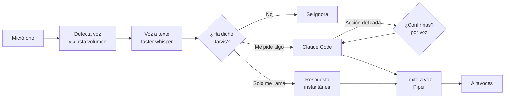

# Jarvis: control por voz vinculado a Claude

Asistente de voz para Windows, en castellano de España. Dices «Jarvis», le pides algo y **Claude Code** hace la tarea en tu PC y te responde en voz alta.

No usa un modelo local ni un asistente ya hecho: este programa solo pone el oído y la voz, y el cerebro es Claude Code con tu propia cuenta.

> **Estado:** primera fase terminada y probada con voz simulada. Falta la prueba con un micrófono real. La segunda fase (control de programas, música y volumen) está pendiente.

## Cómo funciona



## Qué puedes decirle

| Dices | Qué hace | ¿Gasta tokens? |
|---|---|---|
| «Jarvis», «hola Jarvis», «Jarvis, ¿estás ahí?» | Responde al momento y te escucha unos segundos | No |
| «Jarvis, ¿qué hora es?», «oye Jarvis, busca…» | Se lo pasa a Claude | Sí |
| «Jarvis, ¿cuánto consumo llevo?» | Dice el porcentaje de sesión y semanal | No |
| «Jarvis, para» | Corta lo que esté haciendo | No |
| «Jarvis, apágate» | Da el resumen de consumo y se cierra | No |

Tras cada respuesta puedes seguir hablando unos segundos sin repetir su nombre. Solo reacciona a «Jarvis» al principio o al final de la frase, y responde a cualquier voz, no solo a la tuya.

## Instalación

Necesitas Windows, Python 3.12, un micrófono y [Claude Code](https://claude.com/claude-code) con la sesión iniciada.

```powershell
git clone https://github.com/Pareyor/Control-de-voz-vinculado-a-claude.git jarvis
cd jarvis
py -3.12 -m venv .venv
.\.venv\Scripts\python.exe -m pip install -r requirements.txt
.\jarvis.bat
```

La primera vez descarga los modelos de voz y transcripción. Después arranca en unos 4 segundos.

| Opción de `jarvis.bat` | Para qué sirve |
|---|---|
| `--dispositivos` | Lista los micrófonos disponibles |
| `--micro 3` | Usa un micrófono concreto |
| `--interrumpir` | Te escucha también mientras habla (solo con cascos) |
| `--voz edge` | Usa la voz de Microsoft: más natural, pero 1 s más lenta y con internet |

## Qué hay en cada archivo

| Archivo | Qué contiene |
|---|---|
| [`jarvis.py`](jarvis.py) | El programa: oído, voz, conexión con Claude y decisión de qué hacer con cada frase |
| [`permisos.py`](permisos.py) | Decide qué se ejecuta directamente y qué pide confirmación |
| [`uso.py`](uso.py) | Sigue el consumo del plan y genera los avisos |
| [`prueba.py`](prueba.py) | Pruebas de extremo a extremo sin micrófono ni altavoces |
| `jarvis.bat` / `jarvis.ico` | Lanzador e icono para Windows |

Lo que más se suele querer cambiar está al principio de `jarvis.py`: el modelo, la voz, los tiempos de espera, las respuestas fijas y la personalidad (`SISTEMA`).

## Permisos

Todo lo que Claude intenta hacer pasa antes por `permisos.py`, un filtro de código que está fuera del modelo. No depende de que Claude se acuerde de preguntar.

| Sin preguntar | Pide un «sí» por voz |
|---|---|
| Leer archivos y buscar en la web | Borrar o sobrescribir archivos |
| Crear archivos nuevos | Modificar archivos existentes |
| Abrir programas y enlaces | Enviar correos o usar acciones externas |
| Consultar información del sistema | Cualquier comando que no reconozca como seguro |

Si no respondes en 12 segundos o hay dudas, la acción se rechaza.

**Limitaciones:** la confirmación identifica a quien dice «sí» solo por estar cerca del micro, no por su voz. Y una lista de comandos seguros reduce el riesgo, pero no es una garantía absoluta. Vigila lo que le pides.

## Velocidad

Medida desde que dejas de hablar hasta que suena la respuesta, con voz simulada:

| Tipo de orden | Tiempo |
|---|---|
| Respuestas sin Claude («¿estás ahí?») | unos 0,75 s |
| Pregunta normal | unos 2,1 s |
| Tarea compleja | más, pero te cuenta el proceso mientras trabaja |

Reparto aproximado de una pregunta normal: 0,45 s esperando a que termines de hablar, 0,3 s de transcripción en GPU (GTX 1650), de 0,5 a 0,7 s hasta las primeras palabras de Claude y 0,07 s de voz. Claude se mantiene en un proceso abierto para no pagar 2,3 s de arranque en cada orden.

Usa Claude Opus 5.5 (`MODELO_CLAUDE` en `jarvis.py`), el modelo más capaz, porque está pensado también para tareas complejas. En esas tareas dice qué va a hacer antes de cada paso y, si se queda callado 12 segundos, avisa de que sigue trabajando.

## Consumo

Usa el plan de la cuenta con la que hayas iniciado Claude Code, y Opus gasta más que Sonnet. Jarvis avisa cada 10 % de uso de la sesión (ventana de 5 horas) y del semanal, y da un resumen al cerrarse. Los porcentajes son los que envía Claude Code, no estimaciones, aunque solo se actualizan cuando Jarvis hace una consulta.

## Privacidad

- **Tu voz** se transcribe en tu PC y no sale de él. Se envía a Claude el texto de lo que le pides a Jarvis.
- **Las respuestas** se generan en local con Piper. Con `--voz edge`, el texto se envía a Microsoft.
- **El micrófono** se escucha continuamente mientras Jarvis esté abierto, pero el audio no se guarda.

## Pruebas

```powershell
.\.venv\Scripts\python.exe prueba.py --rapida   # lógica, sin red ni tokens de Claude
.\.venv\Scripts\python.exe prueba.py            # completa: gasta algo de tu plan
```

La prueba completa genera frases con voz sintética, las baja de volumen para simular a alguien hablando bajo y las pasa por el mismo camino que el micro real. Con un archivo temporal, comprueba además que un «no» impide borrarlo y un «sí» lo permite.

## Créditos

Usa [faster-whisper](https://github.com/SYSTRAN/faster-whisper), [Piper](https://github.com/OHF-Voice/piper1-gpl) con la voz `es_ES-davefx-medium`, [edge-tts](https://github.com/rany2/edge-tts) y el [Claude Agent SDK](https://github.com/anthropics/claude-agent-sdk-python). Es un proyecto personal sin relación con Marvel ni Anthropic: el nombre es un homenaje y la voz no copia a ningún actor.
